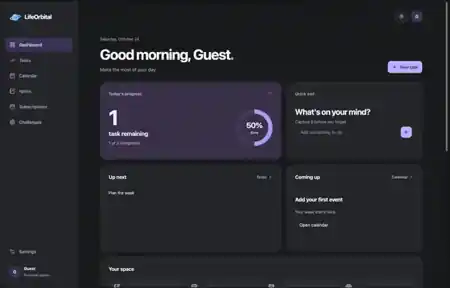
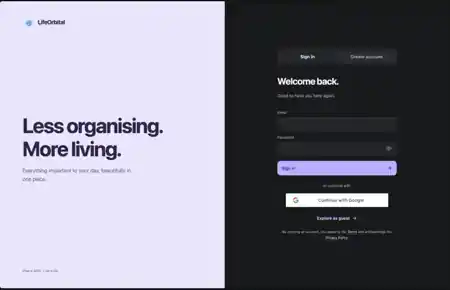

<div align="center">


# LifeOrbital

**Less organising. More living.**

Tasks, calendars, notebooks, subscriptions and progress in one calm personal workspace.

[Live App](https://lifeorbit-pearl.vercel.app/) · [Roadmap](docs/ROADMAP.md) · [Changelog](CHANGELOG.md) · [Contributing](CONTRIBUTING.md)

</div>

## Product

| Page | Purpose |
| --- | --- |
| Dashboard | Daily overview, upcoming items, goals and spending |
| Tasks | To-do lists, drag and drop, completion feedback |
| Calendar | Weekly view, events and one-time .ics import |
| Notes | Book-style chapters and pages |
| Subscriptions | Monthly/yearly costs and next renewal |
| Challenges | Rotating daily and weekly goals, personal progress |
| Settings | Profile, account credentials, theme and export |

## Technology

React + TypeScript + Vite on the frontend. Python FastAPI + Pydantic on the backend. MongoDB Atlas for persistent account data. Google Identity Services and email/password for authentication. Both frontend and backend deploy together on Vercel.

## Screenshots

These are actual screenshots of an earlier development preview. The latest UI may differ slightly.

| Dashboard | Login |
| --- | --- |
|  |  |

See [UX Structure](docs/UX_STRUCTURE.md) for page layouts and interaction patterns.

## Run locally

Requirements: Node.js 22 and Python 3.12.

Frontend:

```bash
npm install
npm run dev
```

Backend in a separate terminal:

```bash
python3 -m venv .venv
source .venv/bin/activate
pip install -r requirements.txt
uvicorn backend.api.index:app --reload --port 8000
```

The frontend runs at http://localhost:5173, with Vite proxying /api to FastAPI.

## Vercel configuration

| Setting | Scope |
| --- | --- |
| MONGODB_URI | Python only; Atlas driver connection string |
| MONGODB_DATABASE | Python database name |
| JWT_SECRET_KEY | Python only; strong signing key |
| GOOGLE_CLIENT_ID | Python verified Google client |
| VITE_GOOGLE_CLIENT_ID | Public Google OAuth web client identifier |
| FRONTEND_ORIGINS | Approved frontend origins |

Use same-origin /api deployment, without a stale VITE_API_BASE_URL. Never commit .env files.

## Data and security

Signed-in tasks, calendar events, notes, chapters, subscriptions and challenge progress are stored per account in MongoDB. Secure HttpOnly cookies are used for signed-in sessions. Google-only credentials remain managed by Google.

Calendar .ics import copies events into the user's MongoDB account. It does not continuously synchronize Google, Outlook or Apple calendars.

The shared leaderboard is not yet implemented. Until real consenting accounts and server-authoritative scores exist, only personal progress is displayed.

Email changes for local password accounts currently require the existing password, but new-email verification is not yet implemented. Do not open that feature for unrestricted public production use until verification, rate limiting, account recovery and session revocation have been reviewed.

## Verify

```bash
npm run typecheck
npm run build
npm audit --audit-level=high
python -m compileall -q backend api
pip-audit -r backend/requirements.txt
```

Check /api/health and /api/health/database after deployment.

See [Deployment](docs/DEPLOYMENT.md), [Security Audit](docs/SECURITY_AUDIT.md), [Architecture](docs/ARCHITECTURE.md), [Design System](docs/DESIGN_SYSTEM.md) and [Team Workflow](docs/TEAM_WORKFLOW.md).

## License

[MIT](LICENSE).

## Calendar and challenges roadmap

The calendar now defaults to a rolling seven-day view beginning today. The arrows move to conventional Monday-based weeks. Month view, timed events, editing and dragging between days use the MongoDB event API. Imports are currently one-time `.ics` uploads. Google Calendar, Microsoft Outlook and Apple CalDAV live synchronization still need separate consent, OAuth or app-specific authorization, encrypted credential storage, background refresh, source mapping and conflict resolution. No account is shown as connected until those services exist.

Challenge suggestions rotate, and users can save recurring personal templates. Public rankings show only accounts that explicitly opt in. Your own profile remains visible to you even if nobody else has joined.
