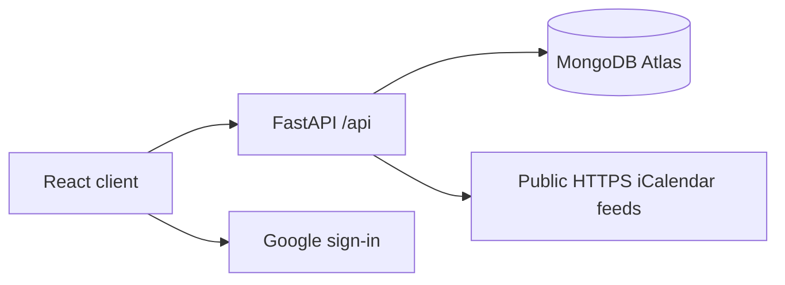

<div align="center">


# LifeOrbit

**Less organising. More living.**

A calm, friendly place to manage your day, plan with friends and make progress.

[Explore the app](https://www.lifeorbit.dev/) · [Features](#features) · [Get started](#get-started) · [Documentation](#documentation) · [Contribute](CONTRIBUTING.md)

</div>

---

## What is LifeOrbit?

LifeOrbit brings schedules, tasks, notebooks, recurring expenses and small daily challenges into one personal workspace. It is an open-source hackathon project, under active development, built by a small team.

| Area | What you can do |
| --- | --- |
| **Dashboard** | See upcoming events, unfinished and overdue tasks, subscriptions and challenge progress |
| **Tasks** | Create and complete tasks, set deadlines and receive in-app reminders |
| **Calendar** | Plan in a weekly time grid or month view; edit, move and resize events |
| **Calendar sources** | Import .ics files or subscribe to public HTTPS/webcal iCalendar feeds, refreshed on demand |
| **Notes** | Organise personal pages into chapters or move notes into shared notebooks |
| **Friends & sharing** | Send friend requests, invite people to events and notebooks, manage event RSVPs |
| **Subscriptions** | Track monthly and annual subscriptions and projected renewal dates |
| **Challenges** | Choose up to three personal and two shared active challenges and view the community ranking |
| **Settings** | Manage your profile, theme, account and data export |

**What is not automatic yet:** subscribed calendars need manual refresh; Google sign-in does not grant Google Calendar access. Notifications refresh while the app is open, not as background push. Shared notebook updates use polling and are not conflict-free simultaneous editing. Calendar gestures and mobile layouts still require cross-browser regression testing.

## Screenshots

Earlier screenshots are retained in [docs/screenshots](docs/screenshots) for historical reference. They are **not** presented as screenshots of the current release. Fresh, verified captures of the deployed version are tracked in the [release checklist](docs/RELEASING.md).

## Technology

| Layer | Stack |
| --- | --- |
| Frontend | React 19, TypeScript, Vite, CSS |
| Backend | Python 3.12, FastAPI, Pydantic |
| Persistence | MongoDB Atlas |
| Authentication | Email/password, Google identity, authenticated cookies |
| Hosting | Vercel, same-origin `/api` |



## Get started

Prerequisites: **Node.js 22**, **Python 3.12**, an accessible **MongoDB** database, and an OAuth web client ID if testing Google sign-in.

```bash
git clone https://github.com/KibouAkari/LifeOrbit.git
cd LifeOrbit
npm install
python3 -m venv .venv
source .venv/bin/activate
python -m pip install -r requirements.txt
```

On Windows PowerShell, activate the Python environment with `.venv\Scripts\Activate.ps1`.

Create your local server environment file from [backend/.env.example](backend/.env.example). Supply real private values using environment variables, or load that local file through your preferred development environment. **The application does not automatically read `.env` without an environment loader.** Never commit credentials.

Start the Python API in one terminal:

```bash
uvicorn backend.api.index:app --reload --port 8000
```

Start React in another:

```bash
npm run dev
```

Open **http://localhost:5173**. Vite forwards `/api` to the local FastAPI server. Verify `http://localhost:8000/api/health` and, with valid Atlas credentials, `/api/health/database`.

Useful checks:

```bash
npm run typecheck
npm run build
python -m compileall -q backend api
```

## Zentral Hack documentation

The challenge-specific documentation is kept **in the repository, not on the website**. It includes the exact MUST/SHOULD requirement mapping, the original problem, a dated 24-hour development log, demo plan, three-minute pitch, feedback template, business hypotheses and disclosures of third-party/AI tools.

**[Read the Zentral Hack dossier](docs/hackathon/README.md)** · [Requirements](docs/hackathon/REQUIREMENTS.md) · [Pitch](docs/hackathon/PITCH.md) · [Evidence](docs/hackathon/EVIDENCE.md)

LifeOrbit was conceived at the start of Zentral Hack: the team collected ideas in Miro, structured features, divided work, chose the technology stack and developed the prototype from scratch. The detailed chronology and evidence are documented in the dossier.

## Documentation

| Guide | Content |
| --- | --- |
| [Product brief](docs/PRODUCT.md) | Vision, principles and scope |
| [Architecture](docs/ARCHITECTURE.md) | Frontend, backend, database and trust boundaries |
| [Frontend guide](docs/FRONTEND_GUIDE.md) | Components, patterns and page conventions |
| [Backend integration](docs/BACKEND_INTEGRATION.md) | API responsibilities and contracts |
| [Data model](docs/DATA_MODEL.md) | MongoDB collections, ownership and concurrency |
| [Social & calendar](docs/SOCIAL_AND_CALENDAR.md) | Sharing, invitations and calendar sources |
| [Deployment](docs/DEPLOYMENT.md) | Vercel, environment variables and verification |
| [Design system](docs/DESIGN_SYSTEM.md) | Palette, visual language and accessibility |
| [Roadmap](docs/ROADMAP.md) | Planned work and known limitations |
| [Release checklist](docs/RELEASING.md) | Quality gates and publishing procedure |
| [Security review](docs/SECURITY_AUDIT.md) | Mitigations, open risks and hardening work |

## Contributing

Issues, documentation fixes, accessibility improvements and focused pull requests are welcome. Start with [CONTRIBUTING.md](CONTRIBUTING.md), follow our [Code of Conduct](CODE_OF_CONDUCT.md) and document user-visible changes in [CHANGELOG.md](CHANGELOG.md).

Security issues should be disclosed **privately**, following [SECURITY.md](SECURITY.md). Do not publish production credentials, personal notes, calendar URLs or exploit details.

## Release status

The public source is **under active development**. A successful deployment does not mean that the service has passed an independent security review. See the [release gates](docs/RELEASING.md) before exposing the service broadly to real users.

## License

Distributed under the [MIT License](LICENSE). Copyright © 2026 LifeOrbit contributors.
