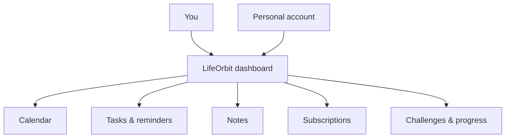

<div align="center">
  
  <h3>Your day, in a better orbit.</h3>
  <p>One calm place to plan your days, capture ideas, stay on top of subscriptions, and turn small wins into lasting habits.</p>
  <p><a href="#the-idea">Explore</a> · <a href="#planned-experience">Features</a> · <a href="docs/ROADMAP.md">Roadmap</a> · <a href="CHANGELOG.md">Changelog</a> · <a href="CONTRIBUTING.md">Contribute</a></p>
  <p>  <a href="LICENSE"></a></p>
</div>

---

## The idea

Modern life is scattered across calendars, notes, to-do apps and subscription portals. **LifeOrbit** is a friendly, minimal life manager that brings the essentials together without making productivity feel like another chore.

> **Less juggling. More living.**

## Planned experience

| Your space | What we're building |
| --- | --- |
| **Home dashboard** | A clear overview of what's coming up, what needs attention and how your week is going. |
| **Calendar** | Events, plans, deadlines and a glance at your schedule. |
| **Tasks** | Simple priorities, due dates, completion and progress. |
| **Notes** | A quick home for thoughts, ideas and things worth remembering. |
| **Reminders** | Helpful nudges for important tasks and upcoming events. |
| **Subscriptions** | One view of active plans, costs and renewal dates. |
| **Daily & weekly challenges** | Small, achievable goals and friendly progress tracking. |
| **Personal accounts** | Secure login and a personal workspace for each user. |

**Project status:** These are product goals, not claims of completed functionality. The implementation and chosen technologies will evolve during the hackathon.

## How it fits together



## Design direction

**Calm and practical.** A soft, approachable visual identity with plenty of breathing room, clear typography and gentle colour accents. Progress should feel encouraging, never guilt-inducing.

**Useful first.** Important information should be visible at a glance, with as few clicks as possible. Accessible contrast, keyboard support and thoughtful mobile layouts matter.

## Getting started

LifeOrbit now uses **React, TypeScript and Vite**. This is a frontend demo;
data currently lives in your browser's localStorage, not in a database.

Requirements: Node.js 20.19+ or 22.12+, npm.

```bash
git clone https://github.com/KibouAkari/LifeOrbit.git
cd LifeOrbit
npm install
npm run dev
```

Open the address printed by Vite (usually http://localhost:5173).

```bash
npm run typecheck
npm run build
npm run preview
```

The first command checks TypeScript and the second produces a Vercel-ready
`dist/` build. There is **no working Python backend or real login yet**.
Do not enter sensitive information into the demo.

## Deployment

The React site is prepared for **Vercel**, framework Vite, output `dist/`.
No deployed URL is configured. A future separate **Python/FastAPI backend**
will connect to **MongoDB**; do not add your database connection string
to Vite environment variables. See [deployment guide](docs/DEPLOYMENT.md)
and [architecture](docs/ARCHITECTURE.md).

## Team development

- [Frontend guide](docs/FRONTEND_GUIDE.md)
- [Product and roadmap](docs/PRODUCT.md) · [Roadmap](docs/ROADMAP.md)
- [Architecture and backend boundary](docs/ARCHITECTURE.md)
- [Changelog](CHANGELOG.md)
- [Contribution guide](CONTRIBUTING.md)
- [Security](SECURITY.md)

## A note on changelogs

Every meaningful user-facing change goes into the **Unreleased** section of [`CHANGELOG.md`](CHANGELOG.md). At release time, move the entries under a dated version heading. See [the release guide](docs/RELEASING.md) for the exact process. Pull requests include a changelog checkbox so updates don't get lost.

## Contributing

Built for a hackathon, and made for people who like building thoughtful tools. Ideas, design feedback, bug reports and pull requests are welcome. Please read [CONTRIBUTING.md](CONTRIBUTING.md) and our [Code of Conduct](CODE_OF_CONDUCT.md).

## License

LifeOrbit is provided under the [MIT License](LICENSE). The project is in an early stage and is not yet a production-ready place for sensitive information.


## Interface update

The React interface now uses a shared lavender and graphite design system, a reworked dashboard, restrained navigation transitions, a login preview with an explicit guest link, and a dedicated 404 page. See [Design system](docs/DESIGN_SYSTEM.md) and [Python backend integration](docs/BACKEND_INTEGRATION.md).
