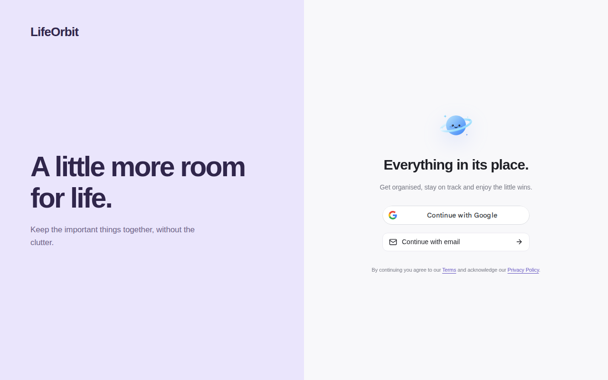
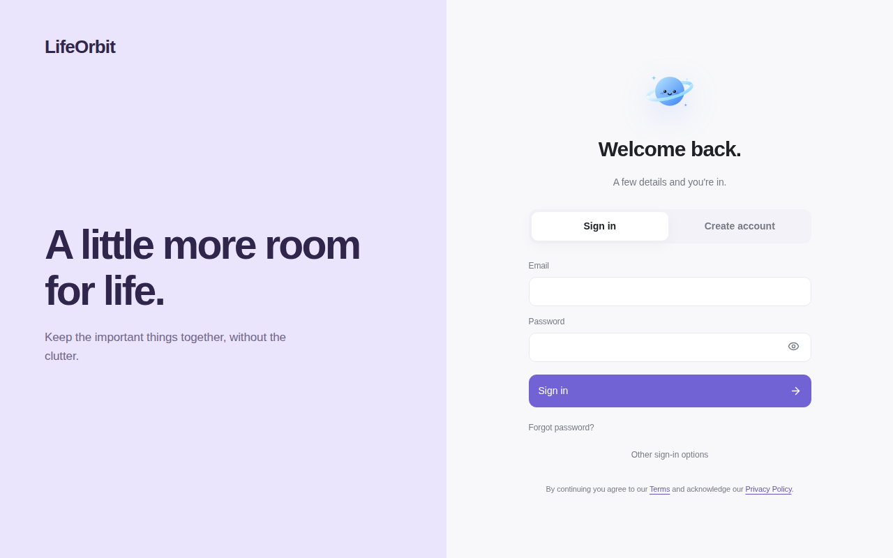

<div align="center">


# LifeOrbit

**Less organising. More living.**

A personal planner for notes, tasks, calendars, friends and everyday progress.

[Application](https://www.lifeorbit.dev/) · [Documentation](docs/README.md) · [Contributing](CONTRIBUTING.md) · [Security](SECURITY.md)

</div>

## What and why

LifeOrbit brings the small pieces of everyday planning into one approachable workspace. It combines personal organization with explicitly authorized collaboration. User-owned data stays private unless sharing is intentionally enabled.

This is an actively maintained open-source application, **not a finished or independently security-certified service**. Documentation distinguishes deployed behavior from features currently in review.

## Features

| Area | Functionality |
| --- | --- |
| Dashboard | Upcoming events, tasks, subscription totals and challenge progress |
| Tasks | Add, complete and order tasks; optional deadlines and in-app reminders |
| Calendar | Week/month planning, appointment edits, read-only event invitations and RSVP |
| Calendar sources | Import .ics files; manually refresh validated HTTPS/webcal subscriptions |
| Notes | Private notebook chapters; invite accepted friends into shared notebooks |
| Challenges | Personal/shared goals and points; private friends ranking and optional community ranking |
| Friends | Friend discovery, requests and accepted-friend invitations |
| Subscriptions | Track billing amount, currency, schedule and renewal |
| Account | Password/Google sign-in, password recovery, profile and workspace export; branded welcome email for new accounts proposed in [PR #74](https://github.com/KibouAkari/LifeOrbit/pull/74) |

### Collaboration and account email status

| Capability | Source and deployment status |
| --- | --- |
| Shared notebook autosave | Merged via [PR #73](https://github.com/KibouAkari/LifeOrbit/pull/73); native Yjs synchronization over short HTTP polling, not instantaneous push |
| Hosted realtime | Optional Liveblocks provider; not enabled without credentials and live permission tests |
| Password recovery | Merged via PR #73; Resend variables exist in production, but sender verification and live delivery are not independently confirmed |
| Leaderboard | Accepted friends can compare private scores, while community rankings still require explicit opt-in |
| Welcome email | New in [PR #74](https://github.com/KibouAkari/LifeOrbit/pull/74); one time after a new password/Google account is created, pending review and release |

**Welcome email design:** The email uses a PNG export of the **same blue planet icon as the website and GitHub**, embedded as a small CID attachment when available (with a first-party URL fallback), readable LifeOrbit text, a single dashboard button, a brief personal welcome and a plain-text alternative. It reuses the configured Resend credentials and does not block registration if sending fails. A one-per-day **Resend welcome email** action is available for signed-in users in [PR #75](https://github.com/KibouAkari/LifeOrbit/pull/75). Existing members can request it themselves; no bulk send is triggered. Inbox placement must be verified in real mailboxes using Resend delivery status and message headers. See [Welcome email](docs/WELCOME_EMAIL.md).

**Email configuration:** Vercel lists all three production variables, `RESEND_API_KEY`, `PASSWORD_RESET_FROM_EMAIL` and `PUBLIC_APP_URL`. Their secret values and real delivery have not been validated in this review. A successful API response does not prove inbox placement; test with your own account before release.

Native autosave remains near-live polling (about 1.3 seconds) and collaboration still needs a two-account production integration test. See the [release checklist](docs/RELEASING.md).

## Technology

| Component | Stack |
| --- | --- |
| Frontend | React 19, TypeScript, Vite, CSS |
| API | Python 3.12, FastAPI, Pydantic |
| Data | MongoDB Atlas |
| Authentication | Signed Secure HttpOnly cookies; password and Google ID token verification |
| Collaboration | Yjs with MongoDB persistence; optional Liveblocks provider |
| Hosting | Single Vercel project with same-origin `/api` routing |

## Local development

Requires Node.js 22, Python 3.12, npm and access to a development MongoDB database.

```bash
git clone https://github.com/KibouAkari/LifeOrbit.git
cd LifeOrbit
npm install
python3 -m venv .venv
source .venv/bin/activate
python -m pip install -r requirements.txt
```

On Windows, activate the environment with `.venv\Scripts\Activate.ps1`.

The root `requirements.txt` mirrors `backend/requirements.txt` so local installation and Vercel deploy the same declared Python dependencies. Keep both synchronized when updating packages.

Set the backend environment values described in [Deployment](docs/DEPLOYMENT.md). Use a local secret manager or exported environment variables. Copying `backend/.env.example` alone **does not load** it into the process. Never reuse production credentials for development.

Start the API and frontend in separate terminals:

```bash
uvicorn backend.api.index:app --reload --port 8000
```

```bash
npm run dev
```

Open [http://localhost:5173](http://localhost:5173). Vite proxies `/api` to the local backend. The API health routes are `/api/health` and `/api/health/database`; the latter needs a configured database.

Validate your changes before opening a pull request:

```bash
npm run typecheck
npm run build
python -m compileall -q backend api
python -m unittest discover -s tests -v
```

Dependency auditing and documentation checks also run in GitHub Actions. Use [Contributing](CONTRIBUTING.md) for review conventions.

## Documentation

Start with the [documentation index](docs/README.md) to find the guides for architecture, API, data model, feature behavior, UI, deployment, operations, security, collaboration and account recovery. Use the [changelog](CHANGELOG.md) for development history and the [release checklist](docs/RELEASING.md) for production gates.

## Privacy and automatic cleanup

In **Settings → Data retention**, signed-in users can opt for automatic removal of completed tasks and old calendar events after **30, 15 or 5 days**, or keep the feature off. New accounts start with 30 days; existing accounts must explicitly opt in to avoid unexpectedly losing old events. The daily scheduled task uses a protected server-side token; it never runs from the browser. Completed tasks are eligible only once a real completion timestamp was recorded. Imported past events are filtered to prevent recreation after cleanup.

**Delete account** schedules account erasure after 30 days and disables logins immediately. Database cleanup is designed to remove related MongoDB records before deleting the user document. External Liveblocks rooms, backups and third-party logs require independent retention and deletion checks, so this is not yet a guarantee of erasure from every copy. See [Privacy retention](docs/PRIVACY_RETENTION.md).

## Screenshots

These screenshots were captured from the **public LifeOrbit website** on 25 November 2026, without signing in or including private account data. They show the current layout before any proposed login redesign. Update the captures after visual changes. Dashboard and notes images require a consent-safe demo account; do not publish screenshots of real user content.

**Sign-in options**



**Email sign-in**



## Security and privacy

Every API operation must validate authenticated ownership and, where applicable, an **accepted current friendship**. Client-side UI visibility is never authorization. Community leaderboard participation is explicitly optional, whereas accepted friends may compare scores privately in the implementation under review.

Never publish API keys, account tokens, calendar subscription URLs, users' personal content or production database credentials. Report security vulnerabilities privately following [SECURITY.md](SECURITY.md).

**Known release blockers:** email provider domain verification and delivery testing, two-account collaborative editing and revocation tests, reliable backup/restore of Yjs content, account recovery and deletion workflows, and independent hosting/security review. See [Security audit](docs/SECURITY_AUDIT.md).

## License

Licensed under the [MIT License](LICENSE). See the [Code of Conduct](CODE_OF_CONDUCT.md) for community standards.
