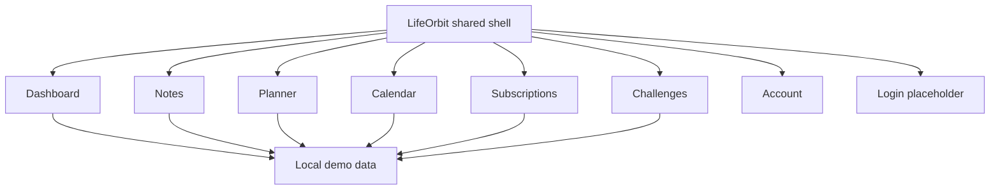

<div align="center">
  
  <h3>Your day, in a better orbit.</h3>
  <p>One calm place for tasks, notes, events, subscriptions and small wins.</p>
  <p>
    <a href="#quick-start">Quick start</a> ·
    <a href="docs/FRONTEND_GUIDE.md">Frontend guide</a> ·
    <a href="docs/ROADMAP.md">Roadmap</a> ·
    <a href="CHANGELOG.md">Changelog</a>
  </p>
  
  
  <a href="LICENSE"></a>
</div>

---

## Welcome to LifeOrbit

Less juggling. More living. LifeOrbit is a minimal, friendly life manager
for all the little things that make up your day.

The current project is an **interactive frontend demo**, not a finished
production app. It uses local browser storage for sample data and has
no real user authentication, server, database, notification delivery or
multi-device synchronisation.

## Quick start

Run a local HTTP server with Python 3:

```bash
git clone https://github.com/KibouAkari/LifeOrbit.git
cd LifeOrbit
python3 -m http.server 8000
```

Open **http://localhost:8000/**. No package installation is necessary.
Changing pages is handled through hash routes such as `#/notes`, which
also works on static hosting.

## What's in the demo?

| Area | Status |
| --- | --- |
| Dashboard | Interactive summary of local demo data |
| Notes | Create, edit and delete text notes |
| Tasks / Planner | Add, complete and remove tasks |
| Calendar | Add and remove events; advanced views planned |
| Subscriptions | Track manual plans, renewal dates and monthly estimates |
| Challenges | Track personal goal progress |
| Account & theme | Demo profile and persistent light/dark preference |
| Login | Visual placeholder; **not actual sign-in** |

## Project map



## Built by a team of three

To keep the experience consistent, **all pages share exactly one sidebar,
one theme system and one component vocabulary.** Start with the
[frontend development and design guide](docs/FRONTEND_GUIDE.md).
The [roadmap](docs/ROADMAP.md) separates core hackathon features from
stretch goals.

## Project documentation

[Product brief](docs/PRODUCT.md) · [UX structure](docs/UX_STRUCTURE.md) ·
[Design standards](docs/FRONTEND_GUIDE.md) ·
[Architecture](docs/ARCHITECTURE.md) ·
[Changelog](CHANGELOG.md) · [Contributing](CONTRIBUTING.md) ·
[Security](SECURITY.md)

## Contribution and releases

Use small feature branches, get a teammate review and update
**[CHANGELOG.md](CHANGELOG.md)** whenever a user-facing change is made.
Details are in [CONTRIBUTING.md](CONTRIBUTING.md) and
[docs/RELEASING.md](docs/RELEASING.md).

Released under the [MIT License](LICENSE). Do not use this early demo
for sensitive personal information.
