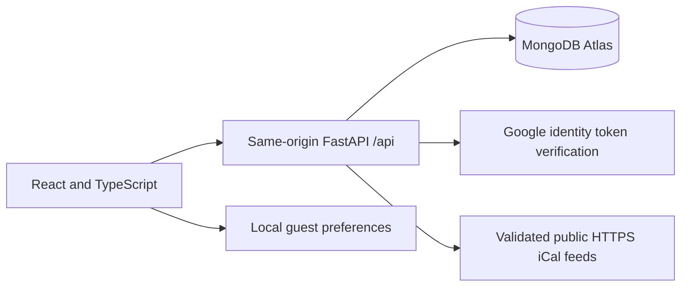

# LifeOrbit architecture

Updated 24 October 2026.

## Technology and responsibility

React, Vite and TypeScript render the responsive application. Vercel serves the frontend and the root Python Function through the same hostname. Python FastAPI validates identity and ownership, accesses MongoDB, and handles subscribed iCalendar feeds.

Authentication accepts email/password or Google sign-in. A signed short-lived session is set in a Secure, HttpOnly, SameSite cookie on `/api`. Google sign-in currently verifies identity only: Google Calendar read/write OAuth scopes are **not** included.

Tasks and calendar events use individual owner-scoped API endpoints. Notes, chapters, subscriptions and challenge progress currently use the owner-scoped aggregate `/api/workspace` endpoint. A future design should split these writes into concurrency-safe resources.

Friends, invitations and sharing use separate MongoDB `friendships` and `shares` collections. The server checks ownership and accepted friendships, including on subsequent read requests. Private note shares are read-only; shared notebooks allow invited members to edit pages with polling, but not conflict-free simultaneous editing.

## Calendar sources

Manual .ics import creates an owned copy. A subscribed public HTTPS or webcal iCalendar link can be saved encrypted and refreshed on demand after public-IP validation and IP-pinned TLS. The server rejects private IP addresses and redirects, and caps file and event sizes. The feed link may contain a private access token; never log or expose it in API responses.

Neither Google Calendar OAuth, Microsoft Graph, nor Apple CalDAV full account integration is implemented. Automatic scheduled refresh requires a background job, token lifecycle, recurrence handling, timezone normalization and security verification.

## Security and operations

Use private Vercel environment variables for MONGODB_URI, JWT_SECRET_KEY and backend Google configuration. Only public Google OAuth client IDs may be prefixed with VITE_. Never place secrets in browser-accessible variables.

Use a stable encryption secret and formal rotation procedure for private feed URLs. Limit query, request sizes and retries, and monitor unusual friend requests or feed fetches. Rate limiting and public-account recovery remain release blockers. See [Security Review](SECURITY_AUDIT.md).
