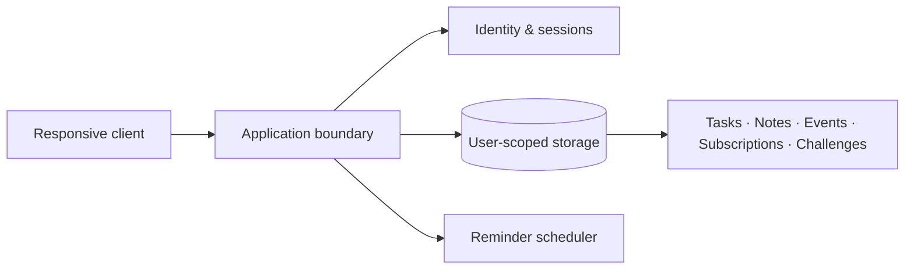

# Architecture notes

No implementation stack has been verified or chosen yet. This document describes required boundaries, not an existing architecture.

## Core entities (proposed)

| Entity | Key fields / relationships |
| --- | --- |
| User | ID, profile settings, preferred timezone |
| Task | Owner ID, title, status, optional due date |
| Note | Owner ID, title/body, timestamps |
| Event | Owner ID, start/end time, timezone |
| Subscription | Owner ID, name, price/currency, next renewal, status |
| Challenge | Definition, cadence, criteria |
| Challenge progress | Owner ID, challenge ID, period, completion |
| Reminder | Owner ID, target, scheduled time, delivery state |

## Engineering guardrails

**Privacy:** Enforce record ownership on the server and avoid exposing user data in logs, analytics or notifications. A client-side filter is not access control.

**Time:** Store instants consistently and retain IANA timezone context for user-facing recurrence. Define daylight-saving and missed-reminder behaviour explicitly.

**Reliability:** Reminder processing should be idempotent to avoid duplicates. Consider retries and observable delivery states.

**Subscriptions:** Treat all financial values as currency-aware; do not assume every renewal is monthly. Manual entry is the MVP default.

**Gamification:** Challenge periods and completion rules must be deterministic, with friendly missed-day handling.

**Security:** Use established authentication libraries, secret management, input validation, rate limiting and dependency updates. Review the threat model before live deployment.

## Architecture decision records

For meaningful stack decisions, add a short document under `docs/decisions/` with context, alternatives and why the team chose one. Do not confuse a proposal with an implemented service.
