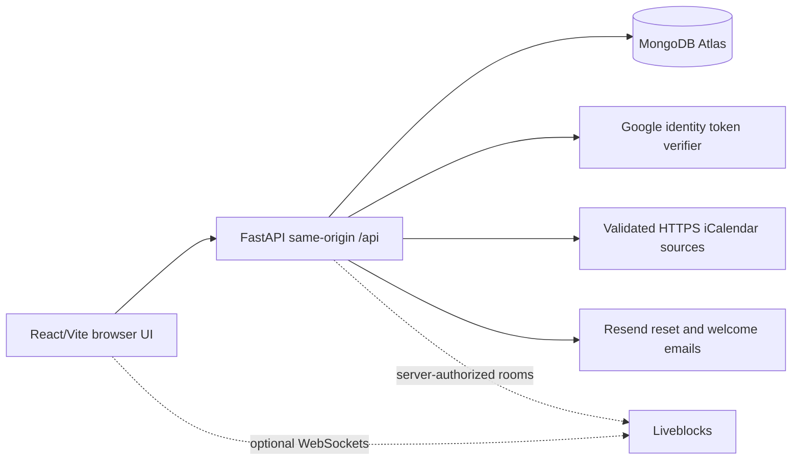

# System architecture

Updated 23 November 2026. PR #73 is merged into main; the welcome email implementation in PR #74 remains a separate proposed change. Check the deployed production commit before assuming a feature is live.

## Runtime and trust boundaries

| Component | Location | Responsibility |
| --- | --- | --- |
| Frontend | `src/react/` | Navigation, UI state, typed requests, optional Yjs editors |
| API entry | `api/index.py`, `backend/api/index.py` | Same-origin FastAPI, request checks, route mounting |
| Authentication | `backend/api/routes/auth.py` | Password/Google login, session issuance and validation |
| Password recovery | `backend/api/password_reset.py` | Single-use recovery tokens and Resend delivery |
| Welcome email | `backend/api/welcome_email.py` | Branded HTML/text onboarding for new accounts via Resend (PR #74) |
| Persistence | `backend/api/database.py` | MongoDB connection and required indexes |
| Workspace and sharing | `backend/api/routes/` | Owner-scoped records and explicit invitations |
| Native collaboration | `backend/api/native_collab.py` | Server-merged Yjs updates in MongoDB |
| Hosted collaboration | `backend/api/realtime.py` | Optional Liveblocks authorization, migration and notifications |
| Hosting | Vercel | Static frontend, Python serverless function, preview environments |

The browser is untrusted. Every private API call must authenticate the account through a signed Secure HttpOnly cookie and validate ownership or a currently accepted friendship. Permission checks in React are convenience only. CSRF Origin validation protects cookie-authenticated mutation requests. Public login and remote-fetch endpoints have server-side throttling.

## Data lifecycle

Owned tasks and calendar events are separate collections. Personal notes, subscriptions and challenge progress currently use aggregate `/api/workspace` writes. These whole-document writes can overwrite edits from another device and need revision-aware replacement.

Shared notebooks store ownership, membership and page metadata in `shared_notebooks`. Merged PR #73 introduced `notebook_crdts` containing canonical Yjs binary state. Authenticated GET/POST sync routes merge concurrent text updates under a distributed notebook lock; MongoDB page previews are a secondary representation. Deleting a page or a notebook must not inadvertently recreate or expose it through stale CRDT state.

Optional Liveblocks sessions instead use private server-authorized room ACLs and hosted Yjs state; they must not run concurrently as a second independent authority over a native room. Before enabling hosted collaboration, verify access revocation, data export, backup/restore, and actual provider behavior. See [Realtime collaboration](REALTIME_COLLABORATION.md).

## External integrations

Google Sign-In verifies identity tokens only. Resend sends password reset messages and, with PR #74, a one-time welcome message after new account creation; both use the same verified sender/domain and three required environment variables. iCalendar sources are fetched with SSRF restrictions and encrypted URL storage; redirects are disabled. None of these services should receive unrelated note contents or session cookies.

## Deployment constraints

A single Vercel project serves both the frontend and `/api`; secrets remain server-side. A READY build checks compilation, not a real MongoDB connection, user authorization, realtime transport or email delivery. Preview and production variable scopes can differ.

For configuration see [Deployment](DEPLOYMENT.md), [Operations](OPERATIONS.md) and [Security review](SECURITY_AUDIT.md).
