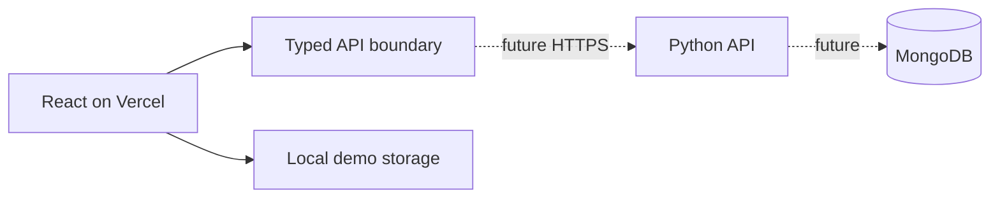

# LifeOrbit architecture

## Agreed stack

| Layer | Technology | Status |
| --- | --- | --- |
| Frontend | React, TypeScript, Vite | Implemented prototype |
| Styling | Shared CSS design tokens | Implemented |
| Frontend hosting | Vercel | Prepared, not deployed |
| Backend | Python, FastAPI (recommended framework) | Planned |
| Database | MongoDB | Planned |
| Authentication | Server-owned sessions | Not implemented |

### Responsibilities

React renders views, validates forms for usability and calls typed services.
**The Python backend** will own authentication, authorization, persistence,
validation, reminder scheduling and all sensitive operations. MongoDB access
happens only from Python. No MongoDB secrets or Python backend credentials
should ever be exposed as `VITE_*` environment variables.

The current demo uses localStorage. See `src/react/data/api.ts` for the
future HTTP boundary; UI pages must not call MongoDB or fetch directly.

### API proposal (not implemented)

Version future endpoints under `/api/v1`, including session/account,
tasks, notes, events, subscriptions, challenges and health checks.
Define a shared OpenAPI contract with typed request/response shapes when
the backend implementation starts. Use string identifiers mapped from
MongoDB ObjectIds server-side.

### Security requirements

Prefer HTTP-only Secure cookies if frontend and API are deployed on
compatible origins. Explicitly decide SameSite, CSRF and CORS behaviour
before cross-origin deployment. Never rely on localStorage display names
as authentication. Every user-owned document must be authorized in Python,
including filtered MongoDB queries. Define rate limits, session expiry,
logging redaction and data deletion.

### Deployment

Vercel builds the **frontend only**. A continuously running Python API and
reminder worker require separately chosen backend hosting. MongoDB Atlas
or another MongoDB deployment can be selected later. There is no assumed
Vercel-hosted Python service.

See [deployment guide](DEPLOYMENT.md) and [team frontend guide](FRONTEND_GUIDE.md).
