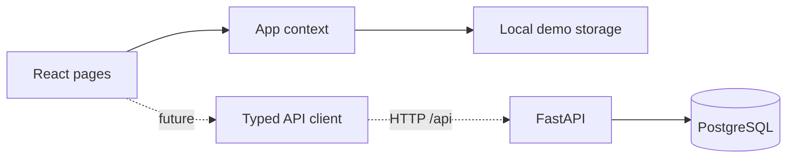

# React frontend and planned Python backend

## Current implementation

Vite + React + TypeScript. All feature pages are React components in
`src/react/pages`. The app shell is `src/react/components/Layout.tsx`.
Theme, navigation and design CSS are shared. Browser-local demo state is
managed in `src/react/context/AppContext.tsx`.

The existing native-JavaScript prototype is retained under `src/pages/`
for migration reference, but is no longer imported or executed by the app.
Do not extend the old files. The Vite entry point is `src/react/main.tsx`.

## Commands

Requires Node.js 20.19+ or 22.12+ and npm.

```bash
npm install
npm run dev
npm run typecheck
npm run build
```

Open the URL shown by Vite (normally http://localhost:5173).

## Planned backend

Recommended: Python 3.12+, FastAPI, Pydantic, SQLAlchemy/Alembic and
PostgreSQL. **Not yet implemented or connected**. Do not pretend local
display names are authenticated identities.



`src/react/data/api.ts` centralises future HTTP calls and has the
`VITE_API_BASE_URL` setting. Vite proxies `/api` to localhost:8000
in development. Build the backend separately in `backend/` when the
team agrees on authentication and API contracts.

Proposed endpoints (not live): `/api/health`, `/api/me`,
`/api/tasks`, `/api/notes`, `/api/events`,
`/api/subscriptions`, `/api/challenges`.

Agree on authentication cookies, CSRF strategy, error payloads, UUIDs,
pagination and date/time handling before switching to the backend.
Server-side authorization must enforce user ownership for all records.

## Three developer agreement

Assign feature pages to different developers. Changes to shared layout,
CSS tokens, app types or state require team review. Every feature PR must
update `CHANGELOG.md` under Unreleased, explain testing and never
claim backend support before it works.
