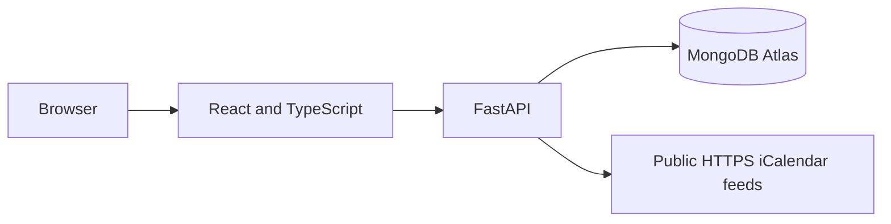

# Technical Architecture and Implementation

## System overview

LifeOrbit is a web application built with a React/TypeScript frontend, a Python FastAPI backend and MongoDB Atlas for persistent account data. Frontend and backend are deployed together through Vercel.

## Application areas

| Component | Implementation |
| --- | --- |
| Accounts | Email/password or Google authentication; account-specific content |
| Dashboard | Combined overview and overdue task indicators |
| Tasks | Creation, completion, deadlines and overdue organisation |
| Calendar | Week/month views, event editing, sharing and RSVP |
| Calendar sources | .ics imports and subscribed public HTTPS/webcal links |
| Notes | Personal chapters and editable shared notebooks |
| Friends | Friend requests and access-controlled sharing |
| Subscriptions | Recurring expenses and renewal information |
| Challenges | Personal and shared progress, community ranking |
| Settings | Account profile, theme and data export |

## Data and permissions

Tasks and calendar events use account-scoped API endpoints. Notes, chapters, subscriptions and challenge data are saved to an account workspace. Shared notebooks and invitations have separate persistence and access checks.

An invited calendar participant may accept or decline an invitation but cannot edit the organiser's event. Shared notebook access is limited to authorised members.

## Calendar integration

A file import creates a copy of external calendar entries. Subscribed iCalendar URLs can be refreshed manually. External requests are restricted to validated public HTTPS destinations with protections against internal network access.

This is not a two-way Google Calendar, Microsoft Graph or CalDAV account integration.

## Technical limitations

- In-app notifications use periodic requests while the application is open; background push is not implemented.
- Shared notebook editing uses periodic refresh rather than conflict-free simultaneous editing.
- Calendar dragging, resizing and mobile interactions require testing across browsers.
- Account lifecycle, security hardening and operational readiness require further work before unrestricted public onboarding.

For more detail, see [Architecture](../ARCHITECTURE.md), [Data Model](../DATA_MODEL.md), [Backend Integration](../BACKEND_INTEGRATION.md) and [Security Review](../SECURITY_AUDIT.md).
