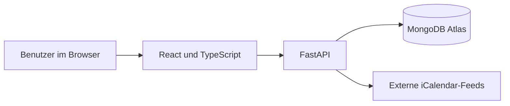

# Technische Umsetzung und Funktionsumfang

## Aufbau der Anwendung

LifeOrbit wurde als Webanwendung mit getrenntem Frontend und Backend aufgebaut. Die Oberfläche basiert auf React und TypeScript. Über die FastAPI-Schnittstelle werden Daten verarbeitet und in MongoDB gespeichert.

Die Anwendung wird auf Vercel bereitgestellt. Dadurch lassen sich Oberfläche und Python-API unter einer gemeinsamen Adresse betreiben.

## Umgesetzte Funktionen

| Bereich | Umsetzung |
| --- | --- |
| Benutzerkonto | Anmeldung per E-Mail/Passwort oder Google und persönliche Datenbereiche |
| Dashboard | Übersicht über wichtige Informationen und Hinweise zu überfälligen Aufgaben |
| Aufgaben | Erstellen, bearbeiten, abschliessen und nach Deadline organisieren |
| Kalender | Wochen- und Monatsansicht, Terminverwaltung und Einladungen |
| Kalenderimport | Einmaliger .ics-Import und abonnierte iCalendar-Links mit manuellem Refresh |
| Notizen | Kapitel, Seiten und gemeinsame Notizbücher |
| Zusammenarbeit | Freundschaftsanfragen, Termineinladungen und Freigaben |
| Abonnements | Erfassung von Kosten und wiederkehrenden Zahlungen |
| Challenges | Persönliche und geteilte Challenges mit Fortschrittsanzeige |
| Einstellungen | Accountprofil, Darstellung und Exportfunktionen |

## Datenhaltung und Benutzerrechte

Persönliche Daten sind einem Benutzerkonto zugeordnet. Gemeinsame Inhalte werden über entsprechende Freigaben zugänglich gemacht. Bei Kalendereinladungen können eingeladene Personen beispielsweise zu- oder absagen, den ursprünglichen Termin jedoch nicht selbst bearbeiten.

Diese Rechte müssen im Backend durchgesetzt werden; eine ausgeblendete Schaltfläche in der Oberfläche allein reicht nicht aus.

## Technische Herausforderungen

**Kalender:** Termine müssen mit korrekten Daten und Uhrzeiten gespeichert werden. Drag-and-drop, Touch-Bedienung und unterschiedliche Browser stellen zusätzliche Anforderungen.

**Zusammenarbeit:** Änderungen sollen bei anderen Personen ohne manuelles Neuladen sichtbar werden. LifeOrbit verwendet dafür derzeit regelmässige Aktualisierungen über die API.

**Datenkonsistenz:** Wenn mehrere Personen dieselbe gemeinsame Notiz bearbeiten, sind künftig weitergehende Mechanismen zur Erkennung und Behandlung von Bearbeitungskonflikten nötig.

**Sicherheit:** Externe Kalenderlinks müssen überprüft und private Daten vor unberechtigtem Zugriff geschützt werden.

## Grenzen des Prototyps

Die Anwendung bietet keine vollständige Echtzeitsynchronisation über WebSockets. Benachrichtigungen funktionieren innerhalb der geöffneten Anwendung; eine zuverlässige Push-Zustellung bei geschlossenem Browser besteht noch nicht. Externe Kalenderabonnements benötigen einen manuellen Refresh. Weitere technische Einschränkungen sind in der [Sicherheitsdokumentation](../SECURITY_AUDIT.md) beschrieben.

## Bezug zur Challenge

Der wesentliche Entwicklungsbeitrag besteht in der gemeinsamen Konzeption und Umsetzung einer funktionsfähigen Anwendung von Grund auf. Der Quellcode, die Dokumentation und die Änderungshistorie zeigen die technische Umsetzung. Für die tatsächliche Demonstration dient der im nächsten Kapitel beschriebene Ablauf.
